<p align="center">
  
</p>

<h1 align="center">Haven</h1>

<p align="center">
  A fast, ad-free launcher for Android TV. No accounts, no tracking. The network is used only by an optional weather widget.
</p>

<p align="center">
  <a href="https://github.com/L1avZh/haven-launcher/actions/workflows/build.yml"></a>
  
  
  
  
</p>

Haven replaces the usual Android TV home screen with something quieter: a 3D character on the start side that follows day and night (and the weather, if you pick a city), a stage in the middle with big artwork and the name of whatever is focused, and a typographic list of your apps at the end. Behind it, a live background drifts in the colors of the focused app's own artwork. It is written in plain Kotlin views with two dependencies (`androidx.recyclerview` and Google Filament for the 3D character), has one permission (internet, for the optional weather widget), and makes no network request unless you choose a weather city.

I built and tested it on a Xiaomi TV Box S (3rd Gen) running Android 14. Other Android TV devices should work, but I haven't tried them (see [Known limitations](#known-limitations)).

<p align="center">
  
</p>

## Screenshots

Every image here is a capture from a physical Xiaomi TV Box S (3rd Gen) running Android 14 over HDMI; no emulator was used. They show a
controlled app list (Plex and Netflix as favorites) and no private data: the weather widget was off and no city is visible.
The Day/Night setting was set to *Always day* or *Always night* for the captures, and the rain, snow, storm and cold scenes were captured on a
debug build with a forced weather reading (see [docs/day-night.md](docs/day-night.md)), because the TV's real weather was neither. A release
build ignores that override. `widgets.png` and `easter-egg.png` come from the previous release; nothing in them has changed.

| | |
|---|---|
|  | 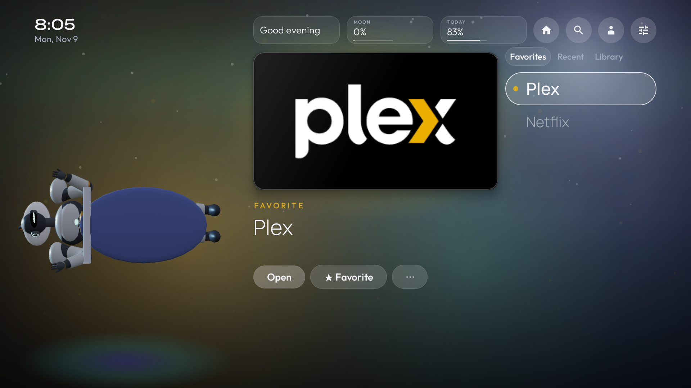 |
| Day: a brighter blue sky with a warm sun glow | Night: the character sleeps under a blanket (the Robot here) and stars come out |
| 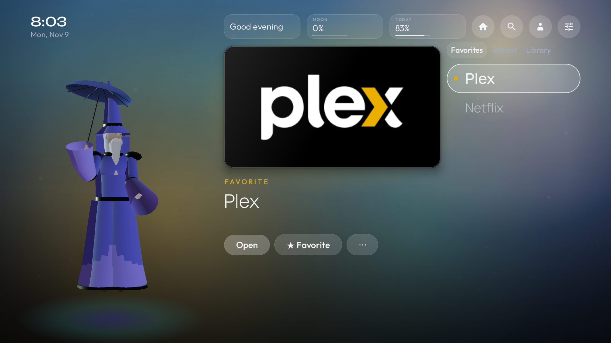 | 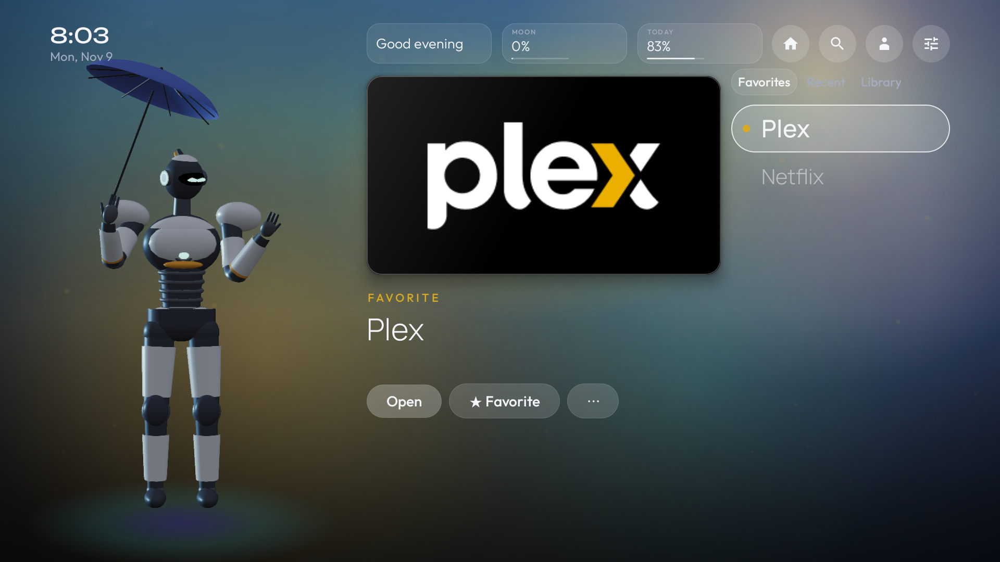 |
| Rain: an umbrella and a hand out to check (forced reading) | Cold, 8 °C or below: umbrella up and the other arm pulled in (forced reading) |
| 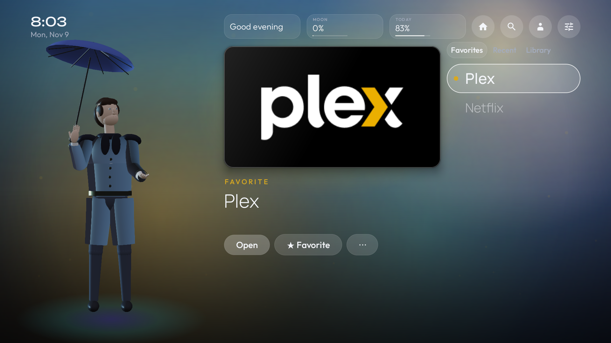 | 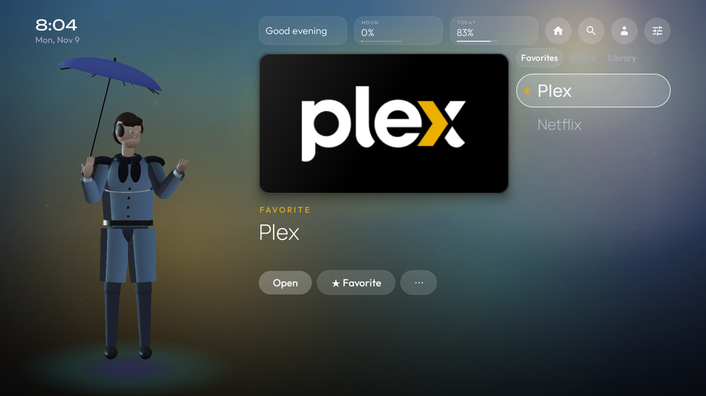 |
| Snow: head tilted up, a palm out (forced reading) | Storm: leaning into the wind (forced reading) |
| 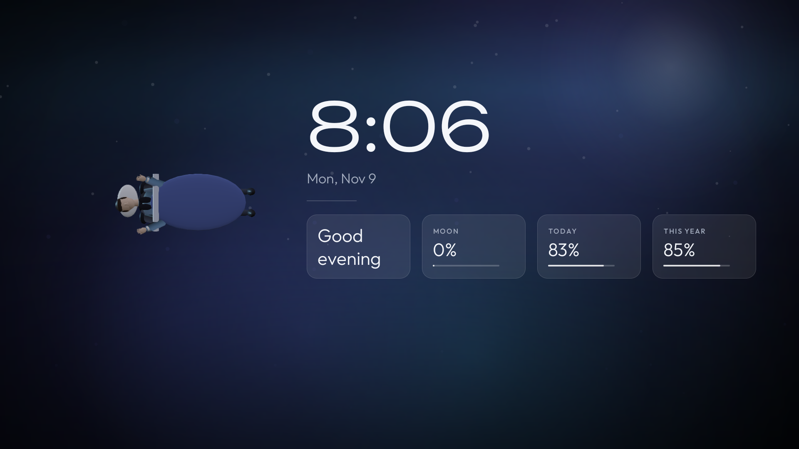 | 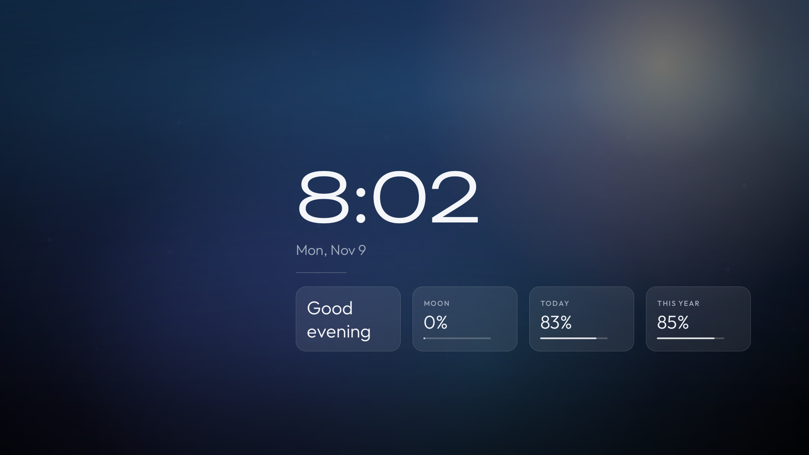 |
| Screensaver at night: four widgets and a sleeping character that drifts with the clock | Screensaver by day: the same layout, a bluer sky |
| 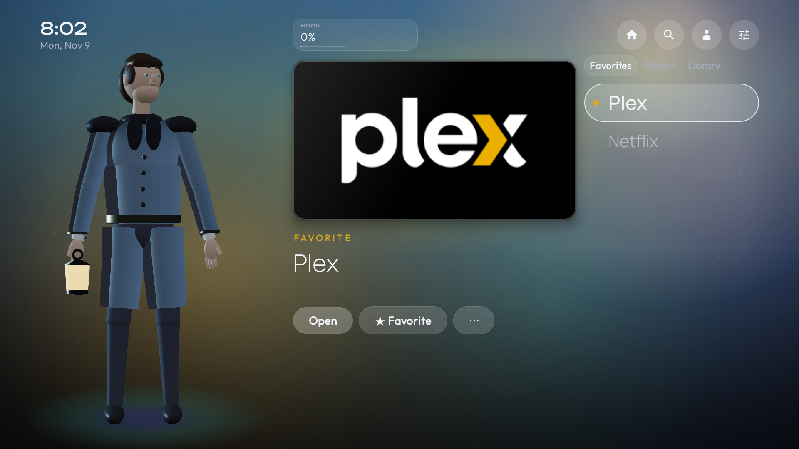 | 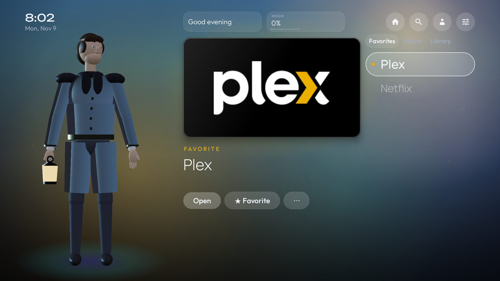 |
| One widget: a single card | Two widgets (three is the home maximum, as in the first image) |
| 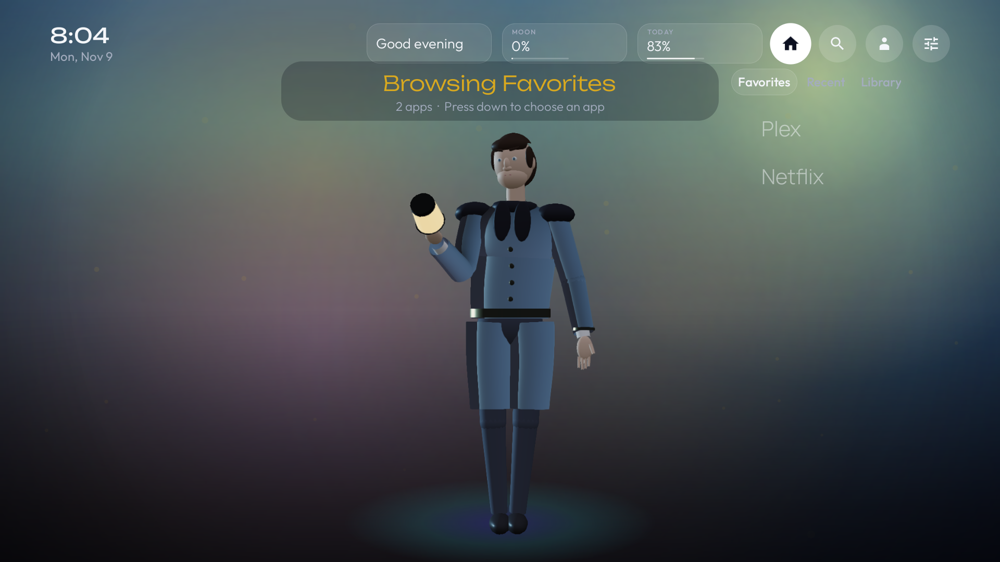 | 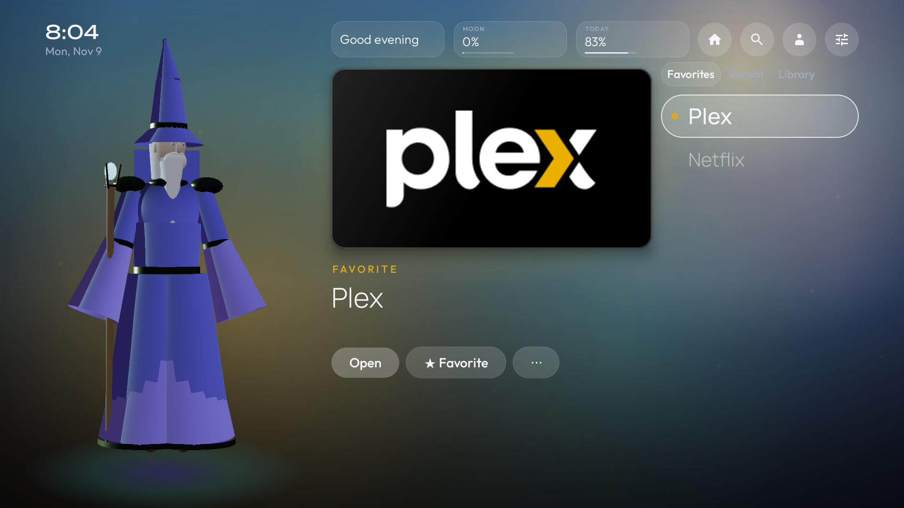 |
| Nothing selected: the character waits in the middle and the source is named | Another character, with the focused app on the stage |
|  | 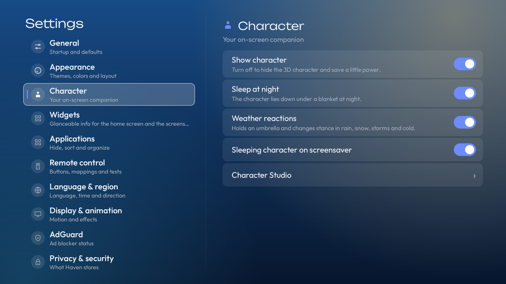 |
| Settings in day mode, with the Day and night rows | Character settings |
| 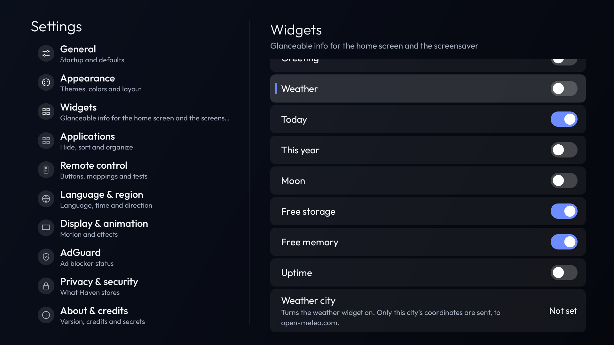 |  |
| Widgets: choose what shows where | The hidden signature |

<p align="center">
  <br>
  <sub>The hidden signature, recorded on the TV.</sub>
</p>

## Features

- **Home screen ("Stage & Rail")**: three scopes, Favorites, Recent and Library, as a list of app names. Each app name uses one of five typefaces, so the list has character. The stage shows large artwork and actions for the focused app. When a scope tab has focus instead of an app, the stage shows the scope's name with a moving light sweep.
- **Live background**: soft color fields and drifting motes that take their palette from the focused app and speed up briefly when focus changes. Rendered at low resolution at 30 fps and paused when not visible; static in performance mode.
- **Day and night**: Settings → Appearance → Day and night is Automatic, Always day or Always night. Automatic uses the daylight flag Open-Meteo already returns for your weather city when that reading is fresh (under 90 minutes old), and otherwise the local clock with a night window you can set (19:00 to 06:00 by default). It follows clock and time-zone changes, and it needs no location permission and no extra network request. The home screen, Settings, the Character Studio and the screensaver all switch between a brighter day sky and the deep night sky, with a short cross-fade (none with reduced motion).
- **Weather and night behavior for the character**: at night it lies down under a blanket and sleeps (switch off in Settings → Character). By day, with a fresh weather reading, rain, snow, storms and cold (8 °C or below, always judged on the Celsius value whatever unit the widget shows) make it hold an umbrella, with a stance for each. Missing, stale or unconfigured weather changes nothing. Night wins over weather, so a sleeping character never holds an umbrella. The prop you chose in the Studio comes back when the weather clears. Rules in [docs/day-night.md](docs/day-night.md).
- **Widgets**: choose what appears on the home screen (up to 3) and on the screensaver (up to 4); each is a glass card whose width is shared evenly for any count, with long text shrinking instead of overflowing (weather has its animated icon, share-type widgets a progress bar): greeting, weather, share of the day, share of the year, moon illumination, free storage, free memory, uptime. Everything except weather is computed on the device. Weather is opt-in: pick a city in Settings and Haven fetches the current temperature and sky from open-meteo.com over HTTPS every 30 minutes. Only that city's coordinates are sent (no key, no account, no device identifier, no location access). In a non-English language, Haven also asks open-meteo's geocoding service once for the city's name in that language and caches it. The icon is animated, and rain, snow and storms also fall across the whole background.
- **Screensaver**: after 2 to 20 minutes without input (or off), a black base with a dimmed live background and the day or night sky, the clock, the date, a thin rule and your widget cards. At night a small sleeping character lies beside the clock (optional). The whole block, character included, moves every 25 seconds and fades while it moves, to spare OLED panels. Any button wakes it. It lives inside Haven and changes no system setting.
- **Characters**: three original rigged 3D characters (Human, Wizard, Robot), rendered with Filament, share the same pose system (including the umbrella, the blanket and the sleeping pose). The character glances at whatever has focus, acknowledges OK and Back, and makes a brief themed gesture when you highlight or open a music or video app (it does not know whether anything is playing). When nothing is selected it stands in the middle in a waiting pose and the screen names the source you are browsing: Favorites, Recent or Library. The Character Studio picks the character, its outfit and its prop; the look is saved locally. There is also a hidden accessory. Everything is local, hides itself if it cannot render, and can be turned off in Settings → Character. See [docs/character.md](docs/character.md).
- **Typefaces**: Outfit for the interface, Unbounded for the clock and big titles, Space Grotesk, Manrope, Sora and Urbanist for app names. All bundled, all SIL Open Font License (see `docs/OFL-*.txt`).
- **App management**: favorites, hide apps without uninstalling them, reorder favorites, show or hide system apps, sort A to Z or newest first, refresh the list. New and removed apps are picked up automatically.
- **Settings**: a full-screen page with ten categories (General, Appearance, Widgets, Applications, Remote control, Language & region, Display & animation, AdGuard, Privacy & security, About & credits). Everything is reachable with a D-pad, OK and Back.
- **Appearance**: six wallpapers, five accent colors plus auto, background dimming, three artwork sizes, 12 or 24-hour clock, screensaver delay, Day and night mode and its night window.
- **Motion**: focus scaling, an entrance animation, glow cross-fades, fading menus. Animation can be full, subtle or off, and there is a performance mode. The system animator scale is respected.
- **50 languages** with native names in the picker and a System default option. Hebrew, Arabic, Persian and Urdu are laid out right-to-left. See [docs/localization.md](docs/localization.md) for what is and isn't verified.
- **Remote control tools**: a button tester that shows what Android actually receives (key, code, device, source, long press), custom button mappings, number keys that open favorites, and an input device list. Details in [docs/remote-control.md](docs/remote-control.md).
- **AdGuard shortcut**: if the official AdGuard app is installed, it shows up like any other app. If not, a tile points to AdGuard's official page. Haven never installs it, never changes VPN or DNS settings, and can't tell whether AdGuard's protection is on.
- **Privacy**: one permission (internet), used only by the optional weather widget and only after you pick a city. No analytics, no ads, no accounts. Preferences live in app-private storage.
- **A hidden signature**: there is an Easter egg. One way to find it is in About & credits.

## Requirements

- Android 8.0 (API 26) or newer. Built against API 35, targeting API 34.
- A D-pad remote. No touch or mouse is needed anywhere.
- Tested on: Xiaomi TV Box S (3rd Gen), Android 14. That is the only device I have verified.

## Install

Download `haven-<version>.apk` from the [Releases](../../releases) page, then:

```bash
adb connect <tv-ip>:<port>        # wireless debugging, see docs/installation.md
adb install -r haven-<version>.apk
adb shell am start -n dev.l1avzh.haven/.MainActivity
```

Haven registers a TV launcher entry, so it should also appear in the TV's app list. More detail, including how to make it the Home app, is in [docs/installation.md](docs/installation.md).

> Release APKs are signed with an ordinary debug key. If you build the app yourself you will have a different key, and Android will refuse to install it over the release APK. Uninstall first in that case.

## Build from source

You need JDK 17 or newer (I use 21) and the Android SDK with platform 35 and build-tools. Then:

```bash
./gradlew assembleRelease
```

The APK is written to `app/build/outputs/apk/release/app-release.apk`. Full steps are in [docs/building.md](docs/building.md).

## Remote control

Haven works with any remote that sends ordinary D-pad, OK and Back keys.

I use an LG Magic Remote with the box connected over HDMI. The TV forwards only a few buttons to the box (HDMI-CEC): the four arrows, OK and Back. I captured the box's key log while pressing every button; the digits, color keys, app buttons, Assistant, Home and volume never arrived. The page [docs/remote-control.md](docs/remote-control.md) has the table, what that means for getting back to Haven from another app, and the things that are not possible without Accessibility access.

## Project layout

```
app/src/main/java/dev/l1avzh/haven/
  MainActivity.kt   home screen, settings content, key handling
  SettingsUi.kt     full-screen settings: categories, rows, switches
  Ui.kt             tiles, icon loader, shared menu dialog, layout helpers
  Tokens.kt         colors, type, spacing, shape and motion values
  HomeUi.kt         app rail, stage buttons, scope hero
  LiveBackground.kt animated background
  Saver.kt          screensaver
  CharacterView.kt  3D character renderer (Filament)
  CharacterLogic.kt roster, input-to-reaction mapping and poses
  AppKinds.kt       music/video/other classification from app metadata
  CharacterStudio.kt outfit and prop picker
  Widgets.kt        widget definitions and the responsive card strip
  DayWeather.kt     day/night and weather rules (pure Kotlin, unit tested)
  Mood.kt           resolves day/night + weather for the whole UI; the sky view
  Model.kt          app discovery and preferences
  Remote.kt         key tester and mapping overlay
  Egg.kt            the Easter egg animation
  Lang.kt           per-app language and script-aware text helpers
  Langs.kt          generated language list
app/src/main/res/   strings for 50 languages, vector icons, locale config
tools/              translation data and generator, haven-home.sh
docs/               guides and images
```

## Known limitations

- Only tested on one device, one Android version, and one remote.
- The firmware on my box ignores a third-party Home app: the Home button still opens Google's launcher. Haven registers as a Home app, but that is up to the device.
- With an LG remote over HDMI-CEC, only arrows, OK and Back reach the box. There is no remote shortcut that works while another app is in front.
- There is no floating Home button. An overlay can't be reached with a D-pad without taking input away from the app underneath.
- City names in the weather picker are English; the widget shows the name in the app's language once it has been fetched.
- Screenshots for the remaining settings pages, the Character Studio and right-to-left layouts are not included.
- The characters are procedurally generated, stylized figures built from primitives and flat-colored materials. They are readable and rigged, but they are **not** at the level of hand-sculpted, textured production characters; getting there needs modelling and texturing work that this project's tools cannot do (see "What would raise the bar" in [docs/character.md](docs/character.md)).
- Day and night follow the weather city's own sunrise and sunset only while a fresh reading exists; otherwise the clock window is used, which is not astronomical.
- The weather scenes in the screenshots were produced with a debug-only forced reading. The live path (real Open-Meteo reading to the same scene) is covered by unit tests, and I observed night and the clock-driven sleep on the TV itself; I did not wait for real rain, snow or cold in the city.
- Older revisions of this repository's history still contain earlier screenshots.
- Translations are machine-assisted drafts. None have been checked by a native speaker.
- Custom wallpapers from files, custom categories and settings export are not implemented.

## Roadmap

- Native review of the translations, starting with the lower-confidence languages.
- A real device matrix: more Android TV and Google TV boxes.
- Settings export and import.
- Optional categories for the library.

## License

MIT, see [LICENSE](LICENSE). Dependencies: AndroidX RecyclerView, the Kotlin standard library and Google Filament (3D rendering), all Apache License 2.0 (Filament's text in `licenses/`). Bundled fonts (Outfit, Unbounded, Space Grotesk, Manrope, Sora, Urbanist): SIL Open Font License 1.1, texts in `docs/`. AdGuard is a trademark of its owner and this project is not affiliated with it. App names and artwork shown in screenshots belong to their owners.

## Credits

Made By [L1avZh](https://github.com/L1avZh).
