<p align="center">
  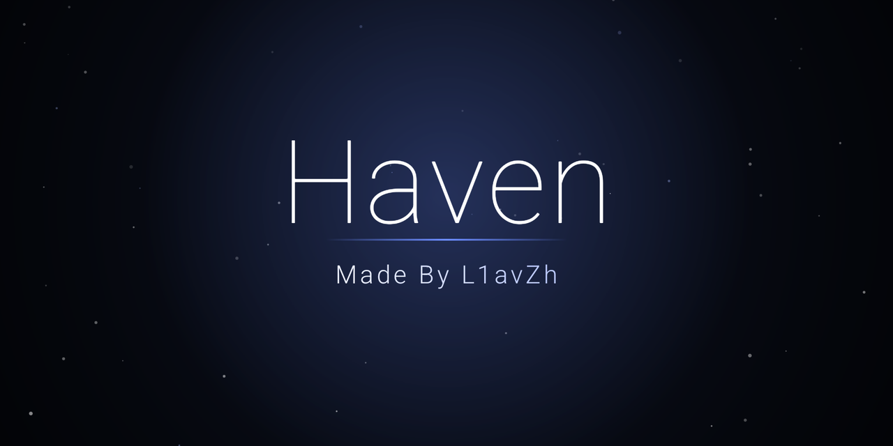
</p>

<h1 align="center">Haven</h1>

<p align="center">
  A fast, ad-free launcher for Android TV. No accounts, no tracking, no network access.
</p>

<p align="center">
  
  
  
  
</p>

Haven replaces the usual Android TV home screen with something quieter: your apps, big artwork, and a hero line that names whatever is focused. The glow behind it takes its color from the app's own artwork. It is written in plain Kotlin views with a single dependency (`androidx.recyclerview`), asks for no permissions, and never touches the network.

I built and tested it on a Xiaomi TV Box S (3rd Gen) running Android 14. Other Android TV devices should work, but I haven't tried them (see [Known limitations](#known-limitations)).

<p align="center">
  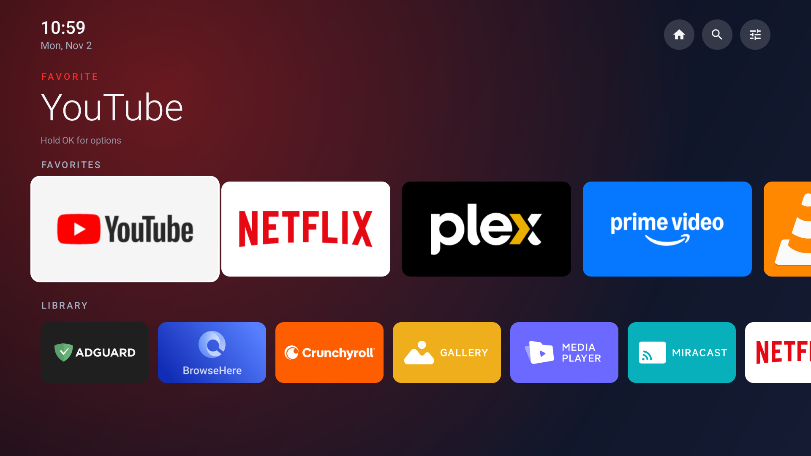
</p>

## Screenshots

All screenshots were captured on the TV itself.

| | |
|---|---|
| 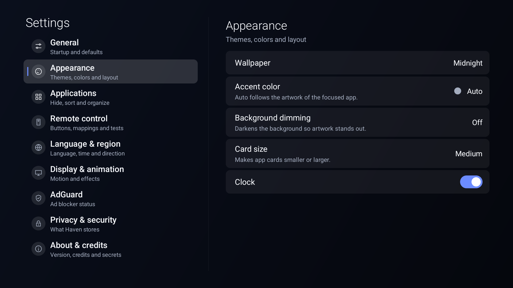 | 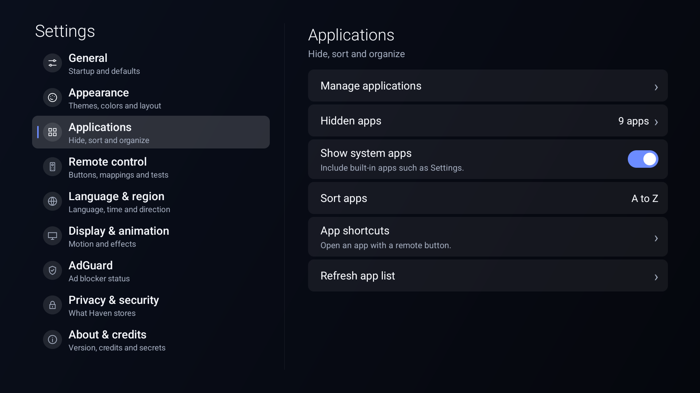 |
| Settings: nine categories, Appearance open | Applications: manage, hide, sort, shortcuts |
| 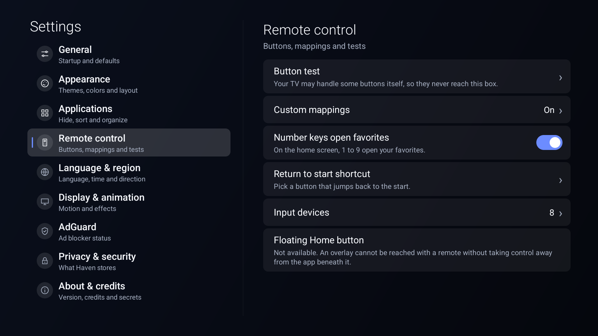 | 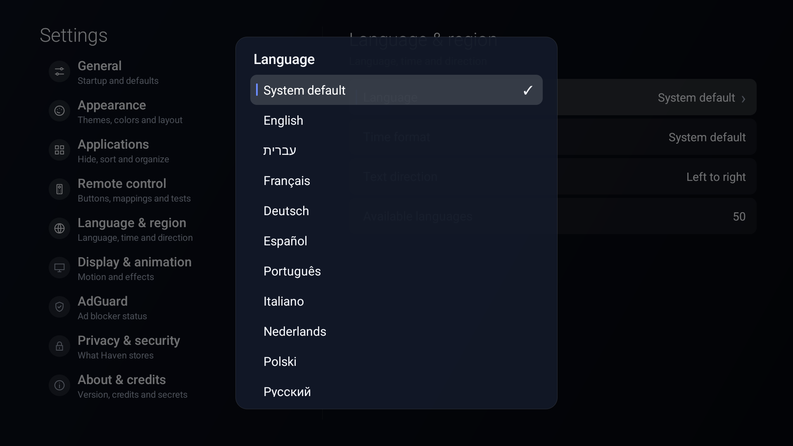 |
| Remote control: button test, mappings, input devices | Language picker (native names) |
| 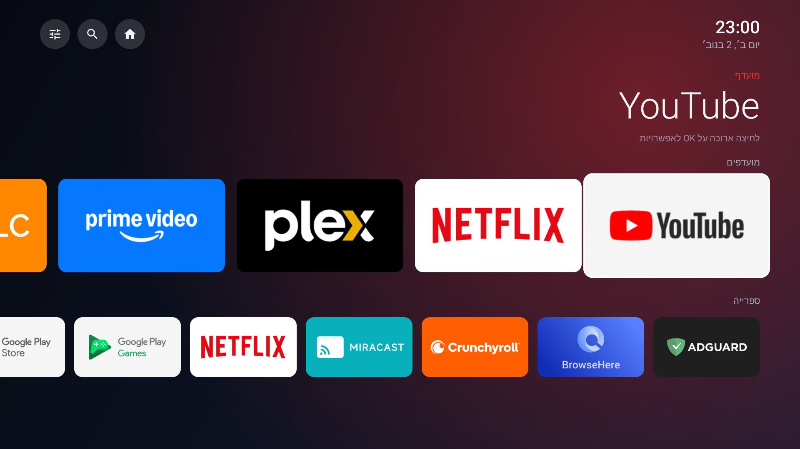 | 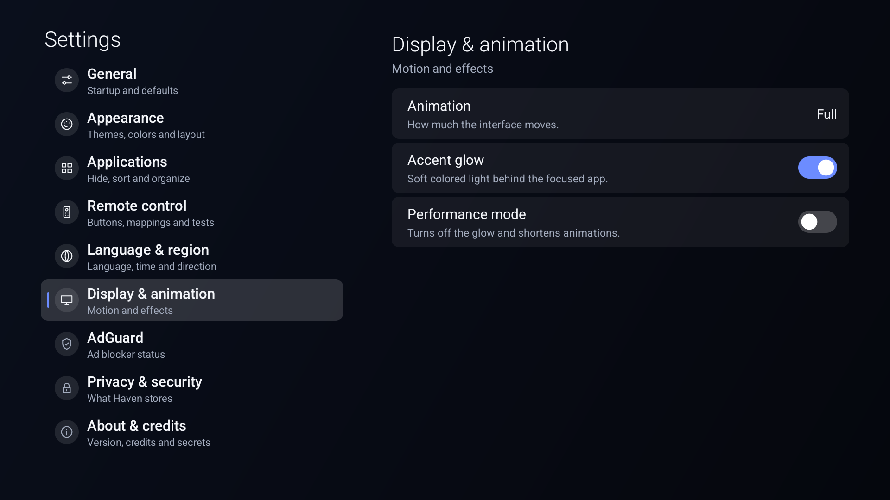 |
| Hebrew, right-to-left | Display & animation |
| 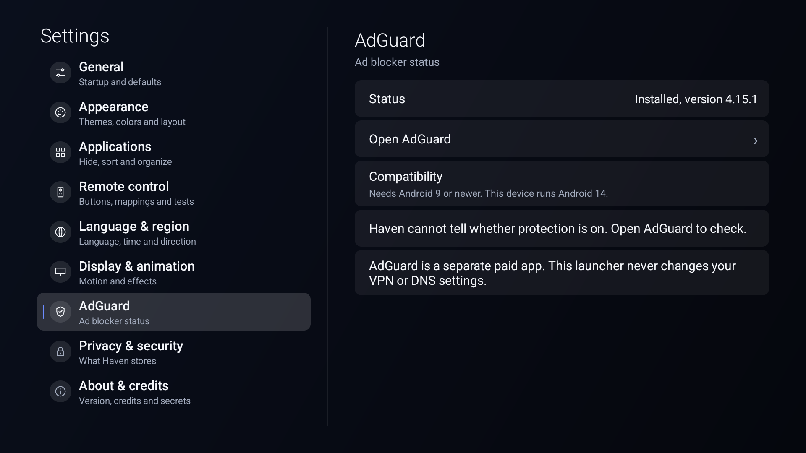 | 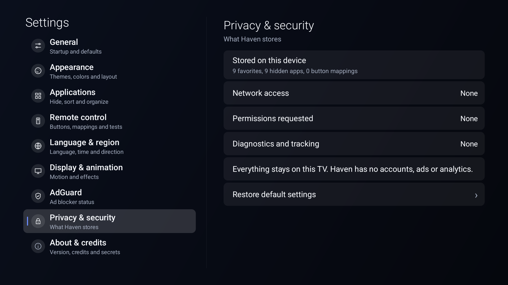 |
| AdGuard status page | Privacy & security |
| 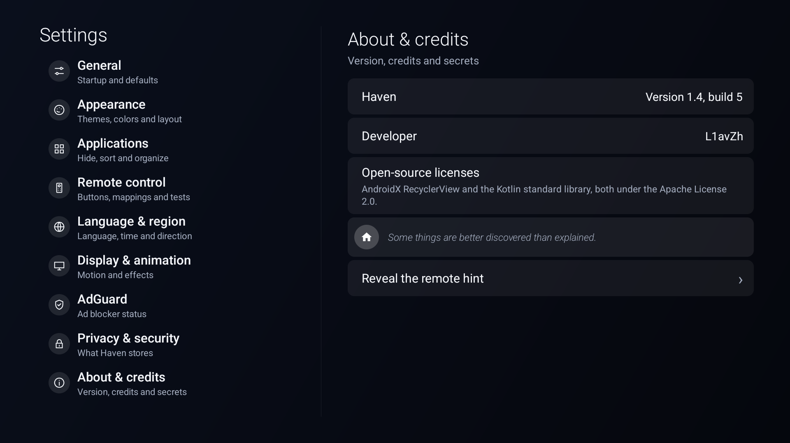 | 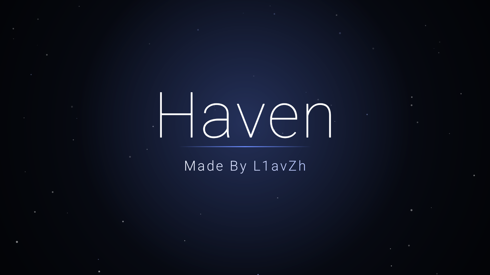 |
| About & credits | The hidden signature |

<p align="center">
  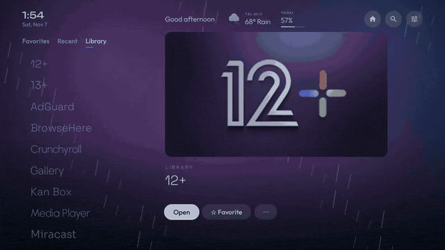<br>
  <sub>The hidden signature, recorded on the TV.</sub>
</p>

## Features

- **Home screen**: a favorites shelf with large artwork, a compact library shelf with every app, a clock, and a hero title for the focused app. The accent glow follows the artwork of the focused app (or a fixed accent color if you prefer).
- **App management**: favorites, hide apps without uninstalling them, reorder favorites, show or hide system apps, sort A to Z or newest first, refresh the list. New and removed apps are picked up automatically.
- **Settings**: a full-screen page with nine categories (General, Appearance, Applications, Remote control, Language & region, Display & animation, AdGuard, Privacy & security, About & credits). Everything is reachable with a D-pad, OK and Back.
- **Appearance**: six wallpapers, five accent colors plus auto, background dimming, three card sizes, 12 or 24-hour clock.
- **Motion**: focus scaling, an entrance animation, glow cross-fades, fading menus. Animation can be full, subtle or off, and there is a performance mode. The system animator scale is respected.
- **50 languages** with native names in the picker and a System default option. Hebrew, Arabic, Persian and Urdu are laid out right-to-left. See [docs/localization.md](docs/localization.md) for what is and isn't verified.
- **Remote control tools**: a button tester that shows what Android actually receives (key, code, device, source, long press), custom button mappings, number keys that open favorites, and an input device list. Details in [docs/remote-control.md](docs/remote-control.md).
- **AdGuard shortcut**: if the official AdGuard app is installed, it shows up like any other app. If not, a tile points to AdGuard's official page. Haven never installs it, never changes VPN or DNS settings, and can't tell whether AdGuard's protection is on.
- **Privacy**: no permissions, no network calls, no analytics, no ads. Preferences live in app-private storage.
- **A hidden signature**: there is an Easter egg. One way to find it is in About & credits.

## Requirements

- Android 8.0 (API 26) or newer. Built against API 35, targeting API 34.
- A D-pad remote. No touch or mouse is needed anywhere.
- Tested on: Xiaomi TV Box S (3rd Gen), Android 14. That is the only device I have verified.

## Install

Download `haven-<version>.apk` from the [Releases](../../releases) page, then:

```bash
adb connect <tv-ip>:<port>        # wireless debugging, see docs/installation.md
adb install -r haven-<version>.apk
adb shell am start -n dev.l1avzh.haven/.MainActivity
```

Haven registers a TV launcher entry, so it should also appear in the TV's app list. More detail, including how to make it the Home app, is in [docs/installation.md](docs/installation.md).

> Release APKs are signed with an ordinary debug key. If you build the app yourself you will have a different key, and Android will refuse to install it over the release APK. Uninstall first in that case.

## Build from source

You need JDK 17 or newer (I use 21) and the Android SDK with platform 35 and build-tools. Then:

```bash
./gradlew assembleRelease
```

The APK is written to `app/build/outputs/apk/release/app-release.apk`. Full steps are in [docs/building.md](docs/building.md).

## Remote control

Haven works with any remote that sends ordinary D-pad, OK and Back keys.

I use an LG Magic Remote with the box connected over HDMI. The TV forwards only a few buttons to the box (HDMI-CEC): the four arrows, OK and Back. I captured the box's key log while pressing every button; the digits, color keys, app buttons, Assistant, Home and volume never arrived. The page [docs/remote-control.md](docs/remote-control.md) has the table, what that means for getting back to Haven from another app, and the things that are not possible without Accessibility access.

## Project layout

```
app/src/main/java/dev/l1avzh/haven/
  MainActivity.kt   home screen, settings content, key handling
  SettingsUi.kt     full-screen settings: categories, rows, switches
  Ui.kt             tiles, icon loader, shared menu dialog, layout helpers
  Tokens.kt         colors, type, spacing, shape and motion values
  Model.kt          app discovery and preferences
  Remote.kt         key tester and mapping overlay
  Egg.kt            the Easter egg animation
  Lang.kt           per-app language and script-aware text helpers
  Langs.kt          generated language list
app/src/main/res/   strings for 50 languages, vector icons, locale config
tools/              translation data and generator, haven-home.sh
docs/               guides and images
```

## Known limitations

- Only tested on one device, one Android version, and one remote.
- The firmware on my box ignores a third-party Home app: the Home button still opens Google's launcher. Haven registers as a Home app, but that is up to the device.
- With an LG remote over HDMI-CEC, only arrows, OK and Back reach the box. There is no remote shortcut that works while another app is in front.
- There is no floating Home button. An overlay can't be reached with a D-pad without taking input away from the app underneath.
- Translations are machine-assisted drafts. None have been checked by a native speaker.
- Custom wallpapers from files, custom categories and settings export are not implemented.

## Roadmap

- Native review of the translations, starting with the lower-confidence languages.
- A real device matrix: more Android TV and Google TV boxes.
- Settings export and import.
- Optional categories for the library.

## License

MIT, see [LICENSE](LICENSE). Dependencies: AndroidX RecyclerView and the Kotlin standard library, both Apache License 2.0. AdGuard is a trademark of its owner and this project is not affiliated with it. App names and artwork shown in screenshots belong to their owners.

## Credits

Made By [L1avZh](https://github.com/L1avZh).
